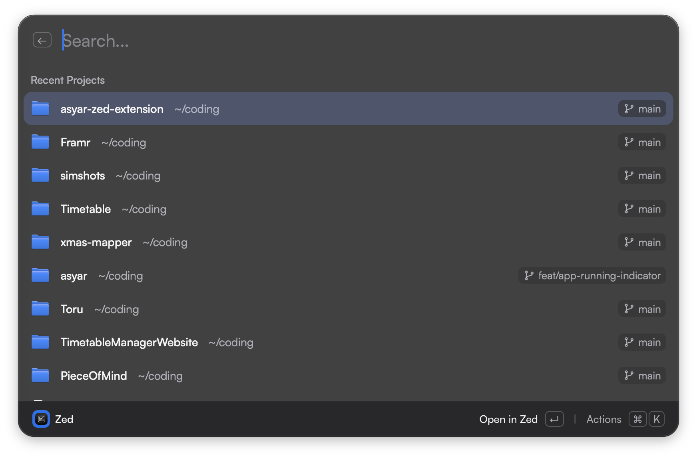

# Zed for Asyar

Open your recent [Zed](https://zed.dev) projects, and whatever is selected in your file manager, from the [Asyar](https://asyar.org) launcher.



## Commands

| Command | What it does |
| --- | --- |
| **Open Recent Zed Project** | Lists Zed's recent local projects, newest first, with each project's git branch. Type to filter by name or path. `↵` opens the project in a new Zed window. |
| **Open with Zed** | Opens the items selected in the file manager in a new Zed window. On macOS, with nothing selected it opens the folder shown in the front Finder window. |

Actions in the recent projects view (`⌘K`):

- **Open in Zed** (`↵`)
- **Open in Finder** / Explorer / File Manager (`⌘⇧F`, `Ctrl+Shift+F` on Windows and Linux)

## Platform support

| | macOS | Linux | Windows |
| --- | --- | --- | --- |
| Recent projects | ✓ | needs `sqlite3` | needs `sqlite3` on PATH (`winget install SQLite.SQLite`) |
| Open in Zed | Zed.app | `zed` or `zeditor` on PATH, or `~/.local/bin/zed` | `zed` on PATH, or `%LOCALAPPDATA%\Programs\Zed\bin\zed.exe` |
| Open with Zed | Finder selection or front window | file manager selection | Explorer selection |
| Folder icons | real Finder icons | generic | generic |

Recent projects come from Zed's local database, opened read-only:

- macOS: `~/Library/Application Support/Zed/db/0-stable/db.sqlite`
- Linux: `$XDG_DATA_HOME/zed/db/0-stable/db.sqlite` (default `~/.local/share/zed/…`)
- Windows: `%LOCALAPPDATA%\Zed\db\0-stable\db.sqlite`

## Permissions

| Permission | Why |
| --- | --- |
| `shell:spawn` (`osascript`, `sh`, `powershell.exe`) | Read Zed's database and run Zed's CLI. Project paths are passed as arguments or on stdin, never spliced into script source. |
| `files:read` (`**/.git/HEAD` only) | Show the git branch of each project. |
| `fs:read` | Reveal a project in the file manager. |
| `selection:read` | Read the file manager selection for **Open with Zed** (Linux, Windows). |
| `cache:read`, `cache:write` | Cache Finder's folder icons so they show instantly next time. |
| `notifications:send` | Report errors from **Open with Zed**, which has no window of its own. |

## Development

```sh
pnpm install
pnpm dev                  # build with hot reload
pnpm exec asyar attach .  # or: build once and register this folder with the launcher
pnpm test                 # unit tests for the pure helpers in src/lib
pnpm build
pnpm exec asyar validate
```
